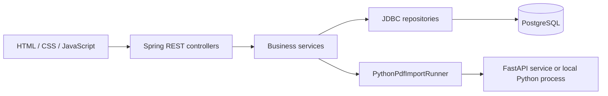
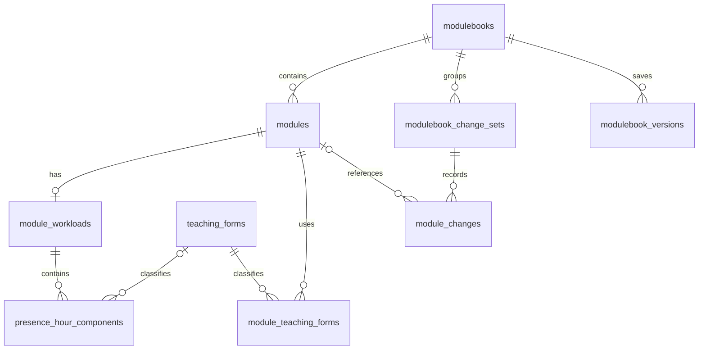

# Architecture

Modulebook serves a browser interface and JSON API from one Spring Boot application. PostgreSQL holds the editable data and history. A Python service extracts module descriptions from PDFs; Java can alternatively run the pipeline as a local subprocess.



## Components and responsibilities

| Location | Responsibility |
| --- | --- |
| `src/main/resources/static/` | Pages and inline page logic; `api.js` centralizes HTTP calls and error formatting |
| `module/` | Module CRUD, status, workload, teaching forms, and change logging |
| `modulebook/` | Handbook identity, saved snapshots, and grouped history/restores |
| `pdfimport/` | Uploads, Python bridge, mapping extracted JSON, and saving reviewed imports |
| `teachingform/` | Teaching-form reference data |
| `config/` | PDF configuration binding and startup migration runner |
| `services/pdf_import_service/` | FastAPI upload service wrapping the Python pipeline |
| `tools/pdf_import/module_import_v2/` | PDF conversion, splitting, field normalization, and reporting |

Java package paths in this table are relative to `src/main/java/de/bht/modulebook/`. Controllers accept HTTP requests and map DTOs; services implement business rules; repositories execute SQL through Spring JDBC. Persistence uses explicit SQL rather than JPA entities.

## Data model

The modulebook is the program/degree workspace, so another study-program management layer would duplicate its current identity and navigation. This simplification is also described in thesis §3.2.1. Structured module data is independent of the publication layout: changing a printable view does not require storing another editable PDF.

The diagram shows the main application relationships, not every column or historical migration constraint:



Workload has at most one summary per module and multiple ordered SWS components. Teaching forms are shared reference data. Separating these repeating structures avoids duplicating module descriptions for every teaching form. `module_changes.module_id` can become null when a module is deleted, preserving its history within the change set.

| Table or view | Purpose and relationships |
| --- | --- |
| `modulebooks` | Handbook identity: study program name and degree; their pair is unique |
| `modules` | Descriptions, credits, status, and comments; belongs to a modulebook |
| `module_workloads` | Optional single workload summary per module, including original imported text |
| `presence_hour_components` | Ordered SWS components belonging to a workload; references teaching forms |
| `teaching_forms` | Shared codes and labels, such as `SU` and `UE` |
| `module_teaching_forms` | Many-to-many relationship between modules and teaching forms |
| `modulebook_change_sets` | One grouped operation, including its reason and source type |
| `module_changes` | Individual changes with a path, old value, and new value |
| `modulebook_versions` | Named JSON snapshots with version metadata and dates |
| `audit_log` | Database-trigger row history, separate from application change sets |
| `module_view` | SQL view assembling module, workload, teaching forms, and components for reads |

`module_view` assembles related records, including JSON aggregates, without denormalizing their underlying storage. It simplifies detailed reads while repositories still write the individual tables. Descriptive fields remain flexible text to preserve irregular imported content; structural constraints protect relationships and uniqueness. Manual-edit DTO validation and import mapping apply different checks, so database flexibility does not imply that every API accepts incomplete module data.

A module number is unique within its modulebook after trimming and lowercasing; blank and null numbers are excluded from that index. Database-generated IDs identify records; module numbers are domain labels. Workload components allow several teaching forms without packing them into a single text field. Raw workload text remains available for comparison with the source.

The final schema no longer has separate study-program, examination-regulation, user, or examination-form tables. Program and degree belong to `modulebooks`; release/regulation dates are saved with versions; examination form is a module field. Earlier migrations contain legacy names and tables, so read the full migration sequence rather than treating the initial schema as current.

Migrations live in `src/main/resources/db/migration/`. Important transitions include V25 (modulebooks become primary), V29 (unused tables removed), V30 (`title` naming), V31 (module-number uniqueness), and V32–V33 (history naming). `DatabaseMigrationConfig` runs Flyway at application startup with baselining enabled. Baselining an existing schema does not verify that it matches the expected historical schema.

## Main request flows

**Edit:** the browser sends a `ModuleRequest`; `ModuleController` validates the request and requires a commit message for updates. `ModuleService` validates identity and uniqueness, persists module/workload/teaching-form changes, and records changes under a change set. Transactional service operations keep related writes together. `changedFieldPaths` preserves unselected scalar module fields and filters change logging; it does not prevent submitted workload or teaching-form data from being saved. An empty selection returns without writing. Clients should not treat this as a general partial-update API for all related data.

**Read:** the browser loads JSON through `api.js`; detailed module reads use `module_view` to assemble related data. Comparisons aggregate recorded changes in the browser; saved-version metadata identifies version points.

**Import:** upload and normalization return a preview without saving modules. A separate save request maps the reviewed data and groups changes under a PDF-import change set. Import saving can partially succeed; it is not one all-or-nothing transaction. See [PDF import](pdf-import.md).

**Print:** `modulebook-view.html` loads current active modules or a saved version's `snapshotJson`, renders the cover, contents, and module pages in JavaScript, and invokes `window.print()`. PDF output uses the browser's print dialog. The saved view remains independent of later edits or physical module deletion; there is no separate backend PDF renderer.

## Workload rules

The editor in `module-edit.html` defines `hoursPerCredit = 30` and `weeksPerSemester = 17` for calculated guidance:

```text
total hours = credits × 30
presence hours from SWS = sum(component SWS) × 17
self-study hours = total hours − presence hours
```

For example, 5 credits and 6 SWS suggest 150 total hours, 102 presence hours, and 48 self-study hours. These are current UI assumptions, not configurable server constants. Changing them requires editing the frontend and reviewing import behavior. Java maps and stores submitted hours; it does not centrally enforce these formulas. Imported raw text and parsed values still require review.

The thesis (§2.2.2) includes a `0.75` hour conversion per SWS that this implementation omits. These docs describe the code; the domain-rule discrepancy remains unresolved. See [source differences](../product/requirements.md#source-and-implementation-differences) before changing the calculation.

## API entry points

| Area | Routes |
| --- | --- |
| Modulebooks | `/api/modulebooks`, `/api/modulebooks/{id}`, `/api/modulebooks/{id}/modules` |
| Modules | `/api/modules`, `/api/modules/{id}`, `/api/modules/{id}/status` |
| Teaching forms | `/api/teaching-forms` |
| PDF preview and save | `/api/pdf-import/normalize`, `/api/pdf-import/modules` |
| History | `/api/modulebooks/{id}/change-sets`, `/api/change-sets/{id}/module-changes`, `/api/modules/{id}/module-changes` |
| Saved versions | `/api/modulebooks/{id}/modulebook-versions`, `/api/modulebook-versions/{id}` |

`{id}` denotes an ID returned by the corresponding API. HTTP methods and request fields are defined in the controllers and DTOs; browser usage is in `api.js`. Restore routes and their effects are documented in [Versioning](versioning.md).

### Request and validation conventions

Normal create/update requests use JSON. Create a modulebook with `studyProgramName` and `degreeType`; the accepted degree values are `BACHELOR` and `MASTER`. A module request requires `modulebookId`, a nonblank `moduleNumber` (maximum 50 characters), a nonblank `title` (maximum 255), and nonnegative `credits`. Updating a module also requires `versionReason`; optional descriptive fields, `workload`, and `teachingFormIds` use the shapes in `ModuleRequest` and its nested DTOs.

The dedicated status endpoint is `PATCH /api/modules/{id}/status` with JSON such as `{"moduleStatus":"DEACTIVE"}`. It enforces `ACTIVE`/`DEACTIVE`; the full module DTO does not apply the same enum-like validation to its status field. Deletions use `DELETE` with query parameter `confirmation=DELETE`. The controllers return HTTP 400 for normal DTO validation failures, 404 for missing entities where checked, and 409 for module/modulebook identity conflicts. Import per-row failures are returned in the save response and can accompany HTTP 200.

Saved-version create requests use `versionMessage` and optional `modulebookReleaseDate` / `studyExaminationRegulationsDate` in `YYYY-MM-DD` format. PDF normalization is multipart upload; reviewed import saving is JSON. Neither import mapping nor workload input has all the validation constraints of the normal module DTO.

## Maintenance boundaries

Authentication and authorization are absent. The repository also includes a PDF diagnostic route (`/api/pdf-import/test-architektur`) tied to a specific fixture. SQL audit history records row changes but does not identify an authenticated actor. Automated Java tests use mocks/stubs for key paths; they do not replace real database, PDF, browser, or deployment checks. Deployment-specific limitations are in [Deployment](../deployment.md).

When adding a module field, review the migration, request/response DTOs, repository SQL and `module_view`, mappers, change logging, snapshot serialization/restoration, browser edit/view/compare/print pages, and import mapping if applicable. Add meaningful checks for the affected behavior and consider compatibility with already stored snapshot JSON.
